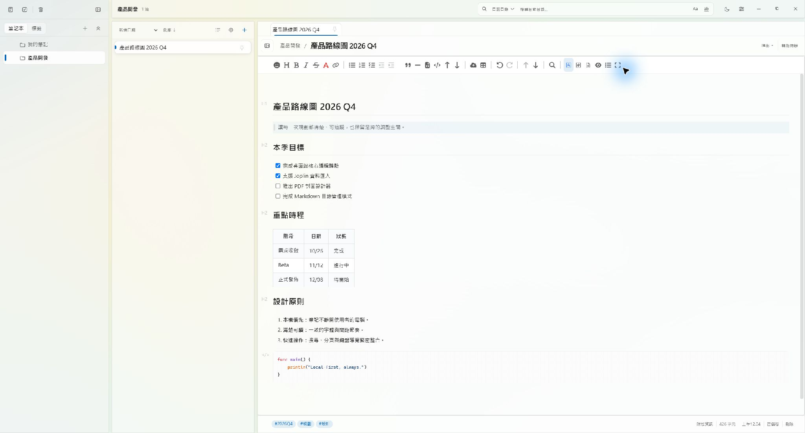
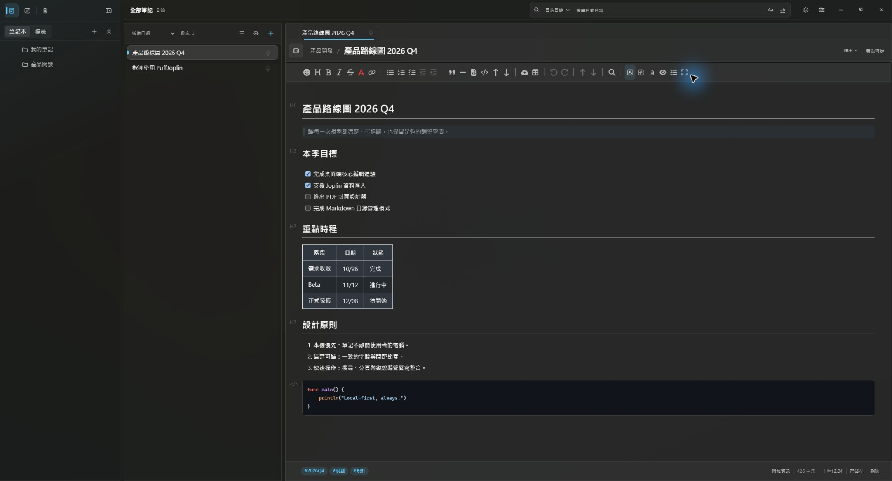
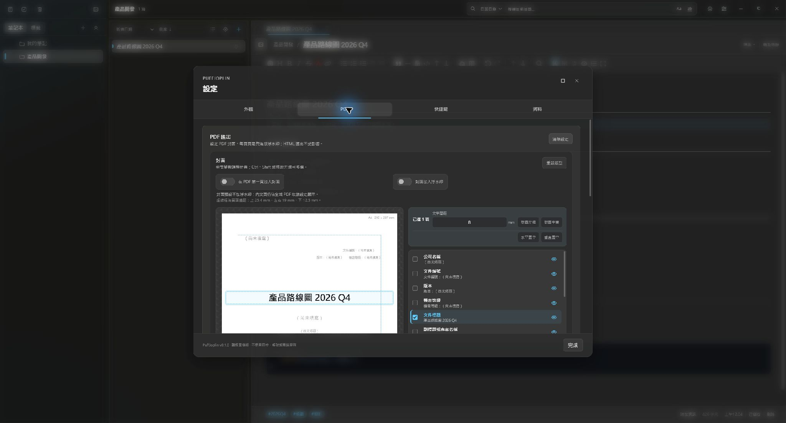

<p align="center">
  
</p>

<h1 align="center">PuffJoplin</h1>

<p align="center">
  以 Go + Wails 打造的 Windows 本機優先 Markdown 筆記軟體
</p>

PuffJoplin 源自 Joplin 的資料格式與使用經驗，但桌面端已改用 **Go、Wails、React 與 SQLite** 重寫。它不需要帳號或網路即可使用，筆記、附件與設定都保存在本機。

目前專注於 Windows 10/11 x64 桌面版，不包含行動版、同步、雲端、E2EE、外掛、AI 或 OCR。

## 介面預覽

<p align="center">
  
</p>

> 畫面使用 [範例 Markdown](docs/examples/product-roadmap.md) 建立。

| 深色模式 | PDF 封面設計 |
| :---: | :---: |
|  |  |

## 功能總覽

### 筆記管理

- 階層式筆記本、子筆記本、標籤、待辦事項與垃圾桶。
- 跨筆記本的「全部筆記」與「待辦檢視」。
- 筆記釘選、排序、摘要顯示切換與目錄遞迴瀏覽。
- 多個釘選分頁，以及一個開啟新筆記時自動替換的預覽分頁。
- 可直接拖曳筆記到筆記本樹變更目錄。
- SQLite FTS5 全文搜尋，支援目前目錄／全部筆記本、標題／內文、大小寫與完整單詞。

### Markdown 編輯

- Vditor 即時渲染與所見即所得模式。
- CodeMirror 6 原始碼模式，支援語法高亮、行號、程式碼折疊與快捷鍵。
- 筆記內搜尋／取代、上一頁／下一頁與全螢幕編輯。
- 自訂文字顏色，提供常用 16 色。
- 剪貼簿圖片、拖放檔案與工具列附件。
- 原始碼模式點擊本機圖片行或 Mermaid 開頭 fence，可開啟浮動圖片檢視器。
- 圖片檢視器支援拖曳、縮放、平移、最大化、另存 PNG 與複製到剪貼簿。
- Fluent Design 介面、Mica 視窗、深色／亮色模式與可調整字型。

### Mermaid 與圖片

- Mermaid 圖表可在編輯器即時顯示。
- 單篇筆記可將所有 Mermaid 圖表匯出為 SVG 或 PNG。
- PDF 匯出前會先將 Mermaid fence 轉成 PNG，避免只輸出程式碼。
- DOCX 匯出支援 Mermaid 圖片內嵌。
- 本機圖片與附件以安全的方式嵌入 HTML／PDF。

### 匯入與匯出

- 匯入 Joplin profile。
- 匯入 JEX、ENEX 或 Markdown 檔案。
- 筆記匯出：PDF、HTML、Markdown、DOCX、Mermaid SVG、Mermaid PNG。
- 筆記本匯出：Markdown 目錄。
- HTML 匯出會內嵌本機附件，不需要原始資料目錄才能開啟。
- 匯出報告會列出略過項目與錯誤原因。

### PDF 正式文件

- A4 PDF、可選文字與標題書籤。
- 可設計 PDF 封面，指定 12 種筆記附加資訊的位置、字級、對齊與啟用狀態。
- 封面設計器支援多選、群組拖曳、水平／垂直置中、等距排列與 A4 邊距參考線。
- 文件標題空白時自動使用筆記名稱。
- 可獨立控制版權宣告頁尾與滿版浮水印。
- 原生頁尾只套用於內文頁，封面上的版權宣告可自由定位。
- 浮水印尺寸、字級、角度、透明度與測試邊框均可調整。

### 直接管理 Markdown 目錄

- 可將磁碟上的實體目錄直接作為筆記本開啟，不需要先匯入。
- 遞迴管理目錄及子目錄中的所有 `.md` 檔案，非 Markdown 檔案不會變成筆記。
- Markdown 檔案是筆記內容的來源；外部修改會自動重新整理索引。
- 插入的圖片保存在原 Markdown 所在目錄的 `images/`。
- 標籤、待辦、釘選與 PDF 封面附加資訊保存在 PuffJoplin SQLite。
- 「停止管理」只移除索引，不會刪除磁碟上的 Markdown 或圖片。

## 技術架構

| 層級 | 技術 |
|---|---|
| Desktop shell | Go、Wails v2 |
| Backend | Go、SQLite、modernc SQLite |
| Frontend | React 19、TypeScript、Vite |
| Rich editor | Vditor 4 |
| Source editor | CodeMirror 6 |
| PDF | Chromium/CDP、Chromedp、pdfcpu |
| DOCX | `@mohtasham/md-to-docx` |
| Search | SQLite FTS5 |

PDF 匯出需要本機已安裝 Chrome 或 Microsoft Edge。程式也會嘗試使用 `PUFFJOPLIN_PDF_BROWSER` 指定的 Chromium 執行檔。

Vditor 的前端資源會在建置時複製並內嵌，執行時不需要連線 CDN。

## 系統需求

### 執行

- Windows 10/11 x64
- Microsoft Edge WebView2 Runtime
- PDF 匯出：Google Chrome 或 Microsoft Edge

### 開發

- Go 1.26 以上
- Node.js 22 以上
- Wails CLI v2.17
- Git

安裝 Wails CLI：

```powershell
go install github.com/wailsapp/wails/v2/cmd/wails@v2.17.0
```

## 開發

取得原始碼並安裝前端相依套件：

```powershell
git clone https://github.com/felixgugu/PuffJoplin.git
cd PuffJoplin
npm --prefix frontend install
```

啟動開發模式：

```powershell
wails dev
```

開發時可以使用獨立資料目錄，避免影響正式筆記：

```powershell
$env:PUFFJOPLIN_DATA_DIR = "G:\Temp\PuffJoplin-dev-data"
wails dev
```

## 測試

完整測試：

```powershell
npm run test:all
```

分開執行：

```powershell
go test ./...
go vet ./...
npm --prefix frontend test -- --run
npm --prefix frontend run build
```

前端測試包含編輯器邏輯、搜尋、分頁、PDF 封面幾何、Mermaid、圖片來源解析與 CSS 結構檢查。

## 建置

```powershell
wails build -platform windows/amd64
```

輸出：

```text
build/bin/PuffJoplin.exe
```

也可以使用專案根目錄的 npm scripts：

```powershell
npm run build
```

GitHub Actions 會在 `dev` 分支與 Pull Request 執行測試、建置 Windows x64 可攜版，並建立 `PuffJoplin-win-x64.zip` artifact。

## 資料位置

預設將程式與資料放在同一個可攜式資料夾：

```text
PuffJoplin/
├─ PuffJoplin.exe
└─ data/
   ├─ puffjoplin.sqlite
   ├─ resources/
   └─ logs/
```

- `puffjoplin.sqlite`：筆記、筆記本、標籤、搜尋索引、設定與附加資訊。
- `resources/`：一般筆記模式使用的附件與圖片。
- `logs/`：程式執行日誌。

WebView2 的 cache、Local Storage 與 GPU cache 由 Windows/WebView2 管理，不屬於筆記資料。舊版遺留的 `data/webview/` 不再使用。

PuffJoplin 採單一實例保護，不允許兩個程序同時操作相同資料目錄。程式目錄必須可寫入；若不具寫入權限，請將整個 portable 資料夾移到使用者可寫入的位置。

關閉程式後，可整份複製 `PuffJoplin.exe` 與 `data/` 進行手動備份或搬移。

## Joplin 資料匯入

首次啟動時會偵測常見 Joplin profile 位置：

```text
%USERPROFILE%\.config\joplin-desktop
%APPDATA%\joplin-desktop
%APPDATA%\Joplin
```

匯入功能以唯讀方式讀取來源資料庫，並透過交易寫入 PuffJoplin SQLite。原始 Joplin profile 不會被修改。

不支援或需要先處理的情況：

- 加密筆記與 Note Lock 筆記需先在 Joplin 解密。
- 已刪除或損壞的來源附件會記錄在匯入報告。
- Joplin 外掛、同步與 E2EE 設定不會匯入。

## 快捷鍵

完整快捷鍵清單位於應用程式的「設定 → 快捷鍵」，目前不提供自訂。常用操作包括：

| 操作 | 快捷鍵 |
|---|---|
| 儲存目前筆記 | `Ctrl+S` |
| 新增筆記 | `Ctrl+N` |
| 全域搜尋 | `Ctrl+F` |
| 筆記內搜尋／取代 | `Ctrl+F`／`Ctrl+H` |
| 所見即所得／即時渲染／原始碼 | `Ctrl+Alt+7`／`Ctrl+Alt+8`／`Ctrl+Alt+9` |
| 分割預覽 | `Ctrl+P` |
| 上一頁／下一頁 | `Alt+←`／`Alt+→` |
| 全螢幕 | `Ctrl+'` |

## 專案結構

```text
.
├─ app.go                    Wails API、生命週期與主要操作
├─ store.go                  SQLite schema、筆記與搜尋
├─ managed_directory.go      實體 Markdown 目錄索引與同步
├─ import.go                 Joplin／JEX／ENEX／Markdown 匯入
├─ export.go                 HTML／PDF 文件輸出
├─ notebook_export.go        Markdown／DOCX／JEX 匯出後端
├─ pdf_cover.go              PDF 封面資料與 HTML 產生
├─ pdf_export_settings.go    PDF 頁尾、浮水印與封面設定
├─ frontend/src/App.tsx      主介面與應用程式狀態
├─ frontend/src/VditorEditor.tsx
├─ frontend/src/codeMirrorSource.ts
├─ frontend/src/PdfCoverDesigner.tsx
├─ frontend/src/SourceLinePreview.tsx
└─ frontend/src/styles.css   主樣式入口
```

## 隱私與限制

- 不建立帳號、不連線雲端、不上傳筆記。
- 沒有同步、行動版、外掛系統、AI、OCR 或 E2EE。
- 直接管理的 Markdown 以原始檔案為準；移動或重新命名檔案時，內容會重新索引。
- 匯出 PDF 時會啟動本機 Chromium 瀏覽器列印，資料不會傳送到外部服務。

## 授權與發佈

PuffJoplin 以 **AGPL-3.0-or-later** 授權發佈；子目錄若包含獨立 `LICENSE` 或 `LICENSE.md`，則以該授權為準。

- 完整授權條文：[LICENSE](LICENSE)
- 專案來源與商標聲明：[NOTICE.md](NOTICE.md)
- 第三方元件與圖示授權：[THIRD_PARTY_NOTICES.md](THIRD_PARTY_NOTICES.md)
- 對應原始碼：<https://github.com/felixgugu/PuffJoplin>

發佈 compiled binary 時，必須同時提供該版本的對應原始碼，並保留 `LICENSE`、`NOTICE.md` 與 `THIRD_PARTY_NOTICES.md`。建議只在乾淨的 Git commit/tag 上建立正式版本。

## 參與貢獻

- 開發與提交規範：[CONTRIBUTING.md](CONTRIBUTING.md)
- 安全性問題：[SECURITY.md](SECURITY.md)
- GitHub Issues 與 Pull Request 範本位於 `.github/`
- 依賴更新由 Dependabot 每週檢查 Go、npm 與 GitHub Actions

本專案源自 Joplin 生態，但不是 Joplin 官方產品。Joplin® 是 JOPLIN SAS 的註冊商標。

- Joplin：<https://github.com/laurent22/joplin>
- Wails：<https://wails.io/>
- Vditor：<https://github.com/Vanessa219/vditor>
- CodeMirror：<https://codemirror.net/>
